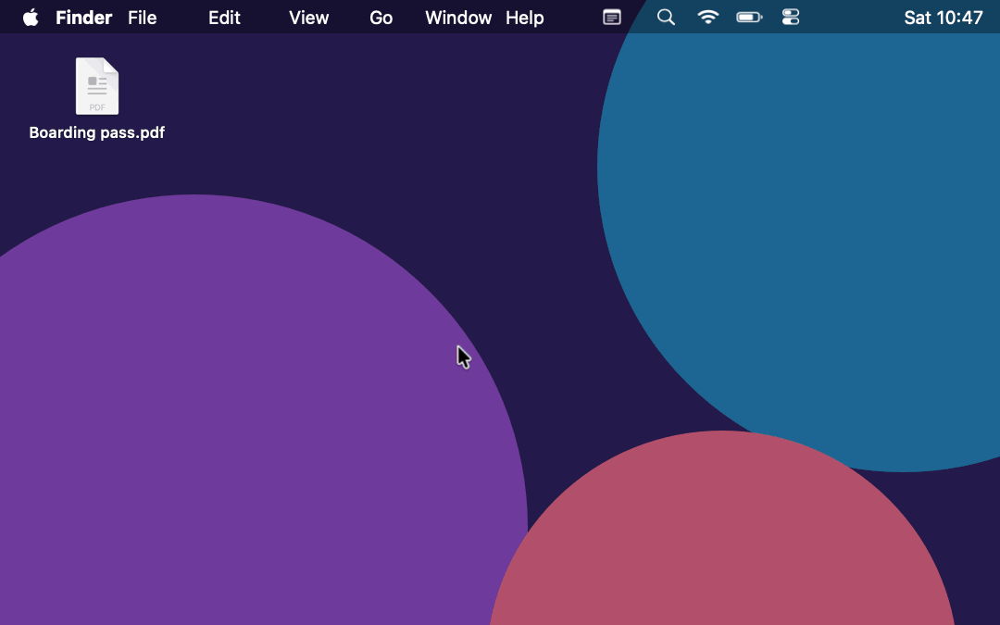
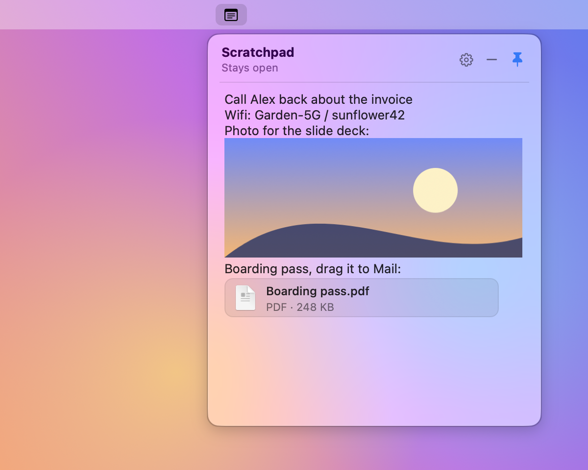
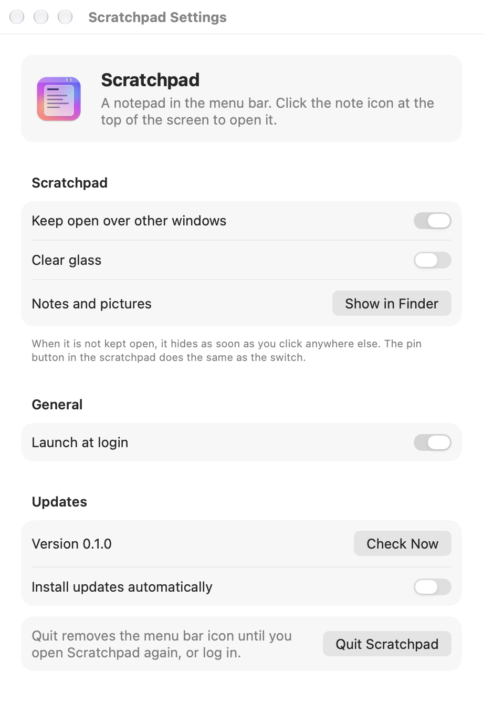

# Scratchpad

<p align="center">
  <a href="https://github.com/SameerCrestha/scratchpad/releases/latest/download/Scratchpad.dmg"></a>
</p>
<p align="center">
  
  
  <a href="LICENSE"></a>
</p>
<p align="center">
  <em><strong>A notepad in your menu bar.</strong> Click the note icon and a glass scratchpad drops down, like Control Center. Type a note, paste a screenshot, park a file, click away. A small Swift app with no tracking.</em>
</p>

<p align="center">
  
</p>

> [!IMPORTANT]
> I don't have a paid Apple Developer account, so Scratchpad is not notarized. The first time you open it, macOS says "Apple could not verify…". This is expected. One Terminal command fixes it, and you only do it once. See [First open](#first-open).

## What it does

<p align="center">
  <picture>
    <source media="(prefers-color-scheme: dark)" srcset="docs/panel-dark.png">
    
  </picture>
</p>

- Click the **note icon** in the menu bar → the scratchpad grows out of it, right under it.
- Click the icon again, the **−** button or press **Esc** → it shrinks back into the icon.
- It **stays open** over your other windows while you work (the pin is on). Drag it anywhere by its header.
- **Unpin it** and it hides as soon as you click anywhere else or switch apps.
- **Paste or drop pictures**: screenshots, "Copy Image" from a browser, image files from Finder. They shrink to fit.
- **Drop in any file**: a PDF, a zip, a document (up to 100 MB each). It shows as a small card with its icon, name and size.
- **Drag pictures and files back out** to Finder, Mail, Slack, a browser upload, any app. You get a copy, and the scratchpad keeps its own.
- **Click a picture** to see it big. Pinch or ⌘+ to zoom, ⌘C to copy it, Esc to close. **Double-click a file** to open it.
- **Copy them out** too: select one and press ⌘C, or right-click it → Copy. A picture pastes as an image, a file as a file.
- **Text pastes plain**, without the fonts and colors of where you copied it from.
- **Saves as you type.** Nothing to save, nothing to lose when you quit.
- **You keep your place.** Typing in the scratchpad doesn't pull the app you were in to the back.

## Highlights

| | |
|---|---|
| **Liquid Glass** | The same glass as Control Center on macOS 26 and later. The frosted menu look on older macOS. |
| **One click away** | Lives in the menu bar. No Dock icon, no window to lose behind others. |
| **Pictures and files** | Paste a screenshot straight in, click it to read it big. Park a file and drag it out later. |
| **Plain file** | Your notes are an `.rtfd` file that opens in TextEdit, pictures and files included. |
| **No tracking** | The only network use is a daily check for a new version on GitHub. |
| **Updates itself** | One click to install, or fully automatic. The update's signature is checked first. |
| **Starts at login** | On by default, one switch to turn it off. |
| **MIT license** | Use it, change it and share it, at home or at work. |

## Why

Parking a phone number, a code or a screenshot for a few minutes usually means a new note or another editor tab, which then gets lost behind everything else. Scratchpad is one place, one click away, that gets out of the way by itself and looks like the rest of macOS.

## Install

Needs macOS 13 or later, on Apple Silicon or Intel. Liquid Glass needs macOS 26 or later.

1. Click **Download for macOS** at the top, or get `Scratchpad.dmg` from the [latest release](https://github.com/SameerCrestha/scratchpad/releases/latest).
2. Open it and drag **Scratchpad** to **Applications**.
3. Let macOS open it. See [First open](#first-open) just below.
4. Open Scratchpad. The scratchpad opens under the new note icon in the menu bar.
5. That's it. It also starts at login.

### First open

> [!IMPORTANT]
> I don't have a paid Apple Developer account, so Scratchpad is not notarized. macOS warns that "Apple could not verify…" the first time you open it. This is expected.
>
> You need to get past this once before the app opens. Use one of the two ways below.

#### Recommended: Terminal (always works)

The quickest way. One command, and it works every time. System Settings sometimes has no **Open Anyway** button.

After you drag Scratchpad to Applications, run:

```bash
xattr -dr com.apple.quarantine /Applications/Scratchpad.app
```

Then open Scratchpad as usual.

#### Other way: System Settings

> [!NOTE]
> This does not work for everyone. If it fails, use the Terminal command above.

1. Open Scratchpad. macOS shows "Apple could not verify…". Click **Done**.
2. Go to System Settings → **Privacy & Security**.
3. Scroll down and click **Open Anyway** next to Scratchpad.
4. Confirm with **Open Anyway** and your password.

## Use

| Do this | To |
|---|---|
| Click the note icon | Open or close the scratchpad |
| Click the pin | Keep it open over other windows, or let it hide when you click away |
| Drag the header | Move it (handy when it is pinned) |
| Drag an edge | Resize it. The size is kept. |
| **Esc**, **⌘W** or **−** | Put it away |
| **⌘V** or drop | Paste text (always plain) or pictures |
| Click a picture | See it big (pinch, ⌘+ ⌘− ⌘0 to zoom, ⌘C to copy, Esc to close) |
| Double-click a file | Open it |
| Drag a picture or file out | Put a copy in Finder or another app |
| Right-click a picture or file | Open, Copy, Open in Preview (pictures), Delete |
| Right-click the note icon | Keep Open, Settings, Quit |
| Gear button | Settings |

Settings:

<p align="center">
  <picture>
    <source media="(prefers-color-scheme: dark)" srcset="docs/settings-dark.png">
    
  </picture>
</p>

- Keep it open over other windows (same as the pin, on by default)
- Show your notes in Finder
- Start at login (on by default)
- Check for updates
- Quit

## Update

Scratchpad checks GitHub for a new version once a day. When one is out, you get a notification.

- Open Settings and click **Install**. It downloads the update, checks it is signed by the same developer, replaces itself and restarts.
- Or switch on **Install updates automatically** and skip the click.
- Or download the new `Scratchpad.dmg` yourself and replace the app in Applications.

## Uninstall

1. Right-click the note icon and click **Quit Scratchpad**.
2. Drag it from Applications to the Trash.
3. Optional: delete your notes in `~/Library/Application Support/Scratchpad`, and remove Scratchpad from System Settings → General → **Login Items**.

## FAQ

**Where are my notes?**
In `~/Library/Application Support/Scratchpad/scratchpad.rtfd`. Settings → **Show in Finder** takes you there. It opens in TextEdit.

**I can't see the note icon.**
On a Mac with a notch, menu bar icons that don't fit are hidden behind it. Open Scratchpad from Spotlight or Applications and the scratchpad opens anyway. Hold ⌘ and drag the icon further right to give it a better spot.

**Does it connect to the internet?**
Only to check GitHub for a new version once a day, and to download an update when you install one.

**Is there a size limit for files?**
100 MB per file. Your notes are kept in memory and saved as one file, so very big files stay out (you hear a beep).

**Why is pasted text plain?**
So a note copied from a web page doesn't bring its fonts and colors along. Pictures still paste as pictures.

## Building it yourself

See [DEVELOPMENT.md](DEVELOPMENT.md).

## License

MIT
